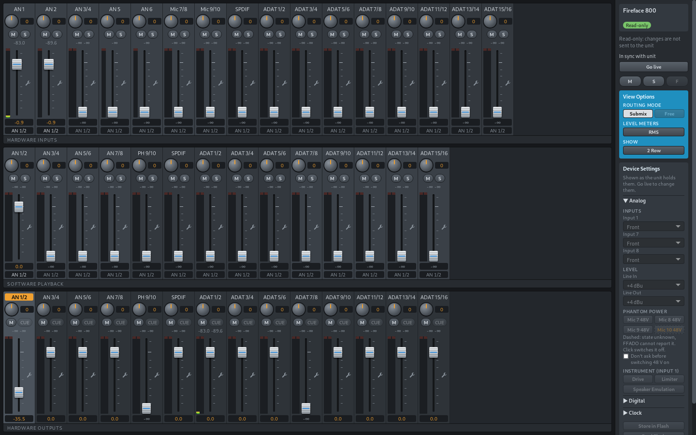
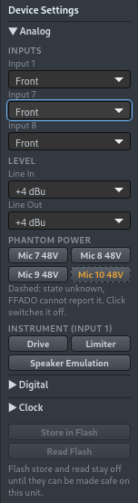

# ffmixer

A mixer and settings app for RME Fireface interfaces on Linux, inspired
by TotalMix FX. It controls the unit through [FFADO](https://ffado.org).

> **Use at your own risk.** ffmixer sends commands to real audio
> hardware. A mistake or a bug could damage microphones or other
> equipment (48 V phantom power), speakers or headphones, or your
> hearing (a sudden loud signal). It has only been tested on one
> Fireface 800 on one Fedora machine. Turn monitors and headphones down
> and disconnect anything delicate before you start ffmixer.
>
> There is no warranty and no liability; see sections 15 and 16 of the
> [license](LICENSE).
>
> Not affiliated with or endorsed by RME. RME, Fireface and TotalMix are
> trademarks of RME Audio.

## Screenshots



Hardware inputs, software playback and hardware outputs. Click an output
to edit what is sent to it.



**Device Settings** has the options from RME's Fireface Settings dialog:
input source, levels, 48 V, instrument options, digital formats and
clock source, plus clock and input lock status.

<br clear="right">

## Supported hardware

| Interface | Status |
|---|---|
| Fireface 800 | Supported. Tested on one unit. |
| Fireface 400 | Not yet. FFADO supports it, but this app is written for the 800's channels, meters and settings. |
| Other Fireface models | Not supported by FFADO. |

Contributions and test reports for other models are welcome.

## Features

- Submix mixer with pan or balance, mute, solo, stereo width, M/S and
  phase, and meters with peak hold.
- Hardware output volume, balance, mute and phase.
- Device Settings: levels, 48 V, instrument options, digital formats and
  clock source.
- Rename channels by double-clicking the name. Names are saved in
  `~/.config/ffmixer/names.json`.
- Faders respond to dragging, the mouse wheel and the keyboard, never to
  a single click.
- Not yet: Talkback, No Trim, Loopback, mono outputs, and storing to or
  reading from the unit's flash. These are shown but disabled.

## How it works

When ffmixer starts it reads the unit's mix and shows live meters. It
sends nothing until you change something, and from then on changes are
sent as you make them. If it can't connect, or the connection drops, the
Control Strip says why and a **Reconnect** button reads the unit again
(changes that were not sent are discarded). Without a unit or FFADO it
starts in demo mode.

Safeguards:

- It can only write mixer gains and the settings in the panel. Flash and
  the sample rate cannot be changed.
- 48 V on, level changes, any instrument option (Speaker Emulation,
  Drive, Limiter) and clock changes ask for confirmation first. The
  **Hide warnings** checkbox at the bottom of the sidebar skips these
  questions; it is off by default and remembered.
- Gains are capped at +6 dB and fade in. Each setting is read back to
  check that it was applied.
- It stops sending if the FFADO server restarts, because a new server
  reloads the saved mix onto the unit.
- Nothing is saved to the unit's flash. The unit forgets the mix when it
  is switched off.

## Setup

See [docs/setup.md](docs/setup.md) for installation, permissions and
troubleshooting. You need:

- A supported Fireface on FireWire, and FFADO 2.4.x (`ffado-dbus-server`).
  The mixer and Device Settings need it; the meters do not.
- Read and write access to `/dev/fw*`.
- To build from source: Node.js 22+, Rust 1.85+ and the WebKitGTK 4.1
  development files.

```bash
cd apps/ffmixer
npm install
npm run tauri dev                     # run the app
npm run tauri -- build --no-bundle    # release binary
```

## Project layout

| Path | Purpose |
|---|---|
| `apps/ffmixer` | The app: Svelte UI, Rust backend (Tauri). |
| `crates/mixer-core` | The mixer model and the rules for safe writes. |
| `crates/ffado-dbus` | Client for `ffado-dbus-server`. |
| `crates/fw-meter` | Reads level meters from the unit. |
| `crates/ffado-probe` | Command-line tool that prints the unit's controls and meters. |

`docs/totalmix-fx-reference.md` has the design notes and what was learned
about the hardware and FFADO.

## License

GPL-3.0-or-later. See [LICENSE](LICENSE).

## Credits

- [FFADO](https://ffado.org): does the mixer and settings control. ffmixer
  talks to it over D-Bus and does not include its code.
- [snd-firewire-ctl-services](https://github.com/alsa-project/snd-firewire-ctl-services)
  by Takashi Sakamoto: documents the meter format. `fw-meter` is a
  separate implementation, not a copy.
- RME's *Fireface 800 User's Guide*, which the UI follows. The manual is
  RME's and is not included here.
